**Conv2D**;

Cherche des petits motifs dans l'image tout en gardant leur position.

* nombre de filtres = le nombre de motifs appris en parallèle.

Chacun peut réagir à quelque chose de différent : un bord vertical, un arc, une pointe claire sur fond foncé. La couche renvoie 32 grilles.

La deuxième en apprend 64. Elle ne regarde plus les 3 couleurs d'origine. Elle regarde les 32 cartes déjà produites. 

Ses motifs sont donc des assemblages : un cercle, un triangle, une barre. C'est pour ça que ce 	nombre est plus grand : il y a plus de combinaisons à représenter.

* Le deuxième argument est la taille du filtre, en pixels. (3, 3) veut dire que chaque filtre regarde un carré de 3 pixels sur 3.

L'image rétrécit donc un peu :

30×30 devient 28×28 après la première convolution ;

le pooling 2×2 la ramène à 14×14 ;

la deuxième convolution donne 12×12, puis le pooling donne 6×6.

La convolution produit des nombres positifs et négatifs. relu garde les positifs et met les négatifs à zéro.


**MaxPooling2D**;

* Rétrécit l'image en gardant seulement le pixel le plus fort de chaque petit carré.

Avec (2, 2), l'image est coupée en carrés de 2 pixels sur 2. Dans chaque carré il y a 4 nombres. La couche jette les 3 plus faibles et garde le plus grand. 

L'image devient deux fois plus petite en largeur et deux fois plus petite en hauteur.

Ça sert à deux choses. Le détail inutile disparaît, et un panneau légèrement décalé ressemble encore au même panneau, parce que seul le signal le plus fort est conservé. 

La couche d'après a donc moins de pixels à regarder.


**Conv2D** regarde un petit carré de 3×3 et le fait glisser partout. S’il apprend à reconnaître un bord ou une flèche, il peut les trouver n’importe où dans l’image. 

**MaxPooling2D** réduit ensuite l’image en gardant le signal le plus fort. Un panneau décalé de quelques pixels reste reconnaissable.


* **categorical_crossentropy** mesure si le réseau a choisi le bon panneau. 
    - Documentation Tensorflow: Use this crossentropy loss function when there are two or more label classes.
* **mean_squared_error** mesure seulement à quel point deux listes de nombres se ressemblent. Mesure l’écart numérique entre deux listes de nombres.
    - Documentation StackOverflow: when you are solving regression problems where you need to predict continuous, numerical values


La perte qui compare cette case gagnante aux 43 probabilités est categorical_crossentropy car il a plusieurs categories. 

Si le bon panneau reçoit une probabilité de 0,05, l’erreur est grande et Adam corrige fortement les poids.

Adam la méthode qui ajuste les poids. Accuracy le pourcentage de panneaux correctement reconnus.

***Début des tests***

*Test 0 ;*

Sans utiliser Conv2D et MaxPooling2D

```python
TEST_SIZE = 1

EPOCHS = 10

optimizer="adam"

loss="mean_squared_error"
```

Resultat de pécision pas plus haut que 0.3914 et loss : 0.0206

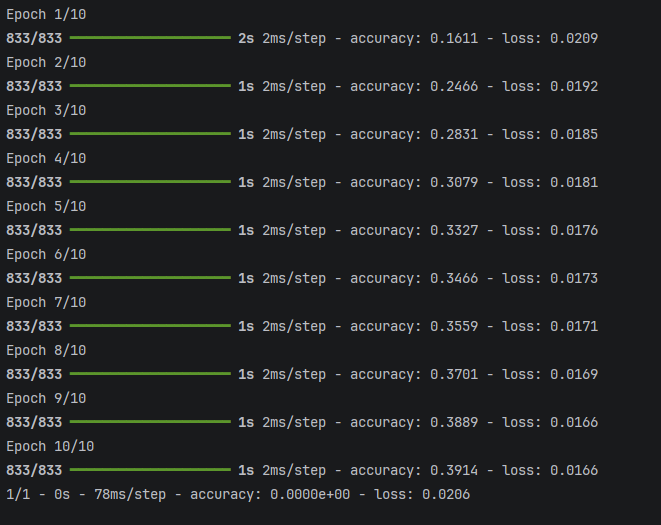


*Test 1;*

Utilisation de deux Conv2D avec un a 32(Exemple de documentation) et l'autre au double avec les deux activation Relu

```python
pool_size = (2,2)

TEST_SIZE = 1

EPOCHS = 10

optimizer="adam"

loss="mean_squared_error"
```

Resultat de précision beaucoup mieux 0.9755 mais loss : 8.2996e-16 avec deux resultat très haut (9.4522e-04 et 8.7330e-04)
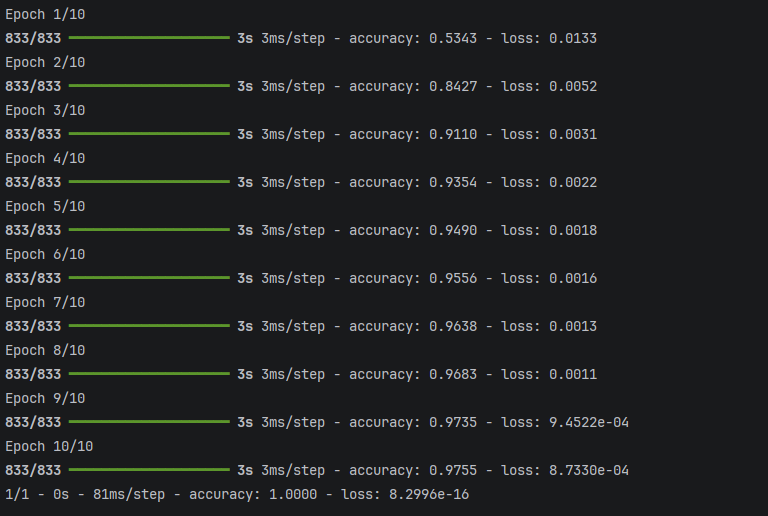


*Test 2;*

Utilisation de trois Conv2D avec un a 32 et l'autre au double et le dernier triple avec les trois activation Relu


```python
pool_size = (2,2)

TEST_SIZE = 1

EPOCHS = 10

optimizer="adam" 

loss="mean_squared_error" 
```

Resultat de pécision de 0.9861 mais beaucoup de perte. 5 entrainement avec perte entre 4.9802e-04 et 9.3795e-04
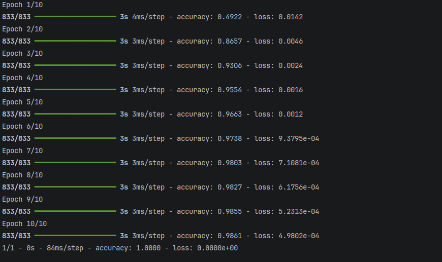


*Test 3;*

Utilisation de 4 Conv2D avec un a 32 et l'autre 64, 96 et le dernier 128 avec les 4 activation Relu

```python
pool_size = (2,2)

TEST_SIZE = 1

EPOCHS = 10

optimizer="adam" 

loss="mean_squared_error" 
```

CA PLANTE! Plante apres 128 car la grille est rendu plus petite que le filtre. 

Car apres 92 filtres grille 4×4 apres pooling grill 2×2 donc faire 128 apres est impossible.
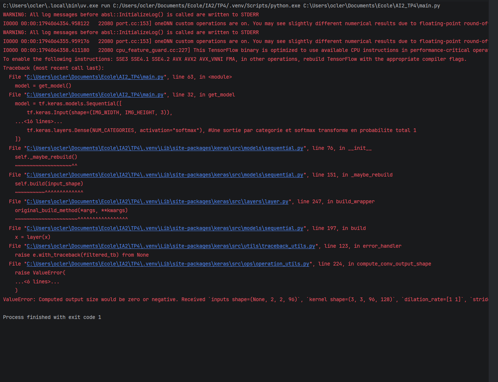


*Test 4;*

Utilisation de deux Conv2D avec 32 et les deux activation Relu

```python
pool_size = (2,2)

TEST_SIZE = 1

EPOCHS = 10

optimizer="adam"

loss="mean_squared_error"
```

Resultat de précision de 0.9688 et perte très basse.
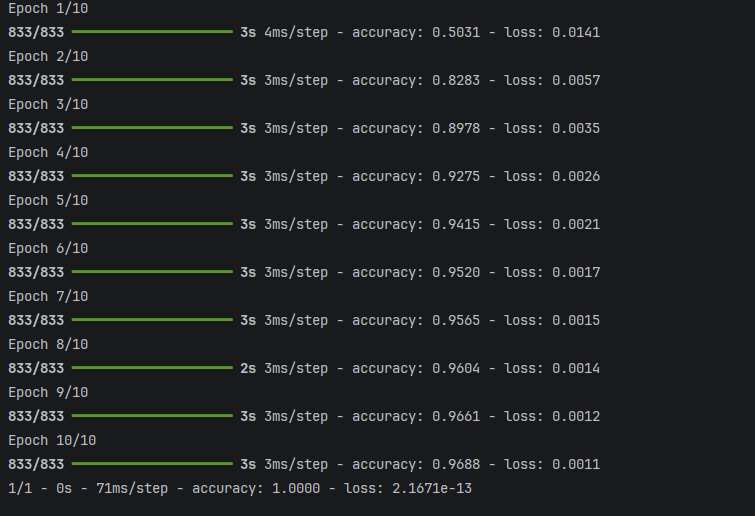


*Test 5;*

Utilisation de trois Conv2D avec un a 32 et l'autre 64 et le dernier 96 avec les trois activation Relu

```python
pool_size = (2,2)

TEST_SIZE = 1

EPOCHS = 10

optimizer="adam"

loss="categorical_crossentropy"
```

Resultat de précision de 0.9855 et perte la plus haute 1.6429.
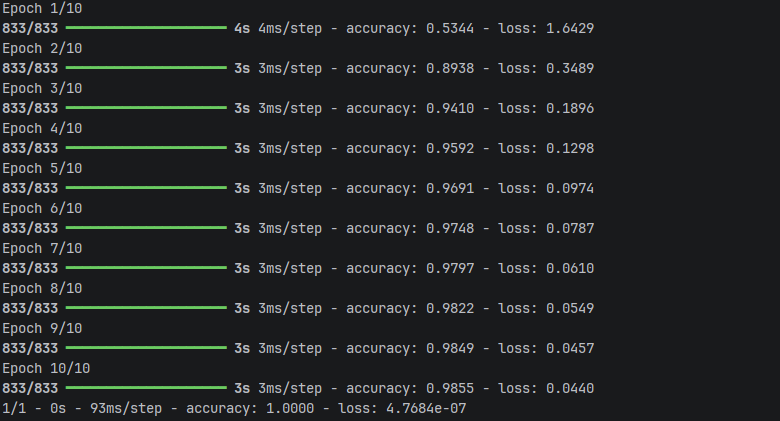


*Test 6;*

Conv2D 32, 64, 128

```python
pool_size= (2,2)

TEST_SIZE = 1

EPOCHS = 10

optimizer="adam"

loss="categorical_crossentropy"
```

Resultat de précision de 0.9873 et perte la plus haute 1.6062.
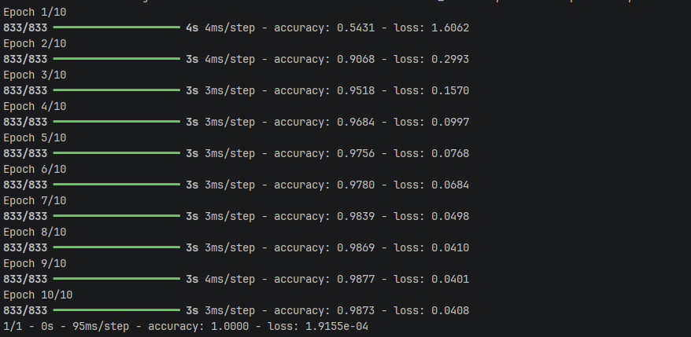


*Test 7;*

Conv2D 32, 64

```python
pool_size= (3,3)

TEST_SIZE = 1

EPOCHS = 10

optimizer="adam"

loss="categorical_crossentropy"
```

Resultat de précision de 0.9736 et perte la plus haute 2.0359.
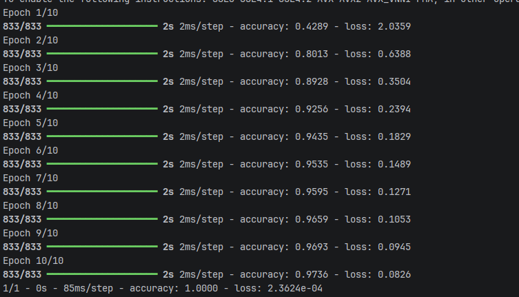


*Test 8;*

Conv2D 32, 64

```python
pool_size= (4,4)

TEST_SIZE = 1

EPOCHS = 10

optimizer="adam"

loss="categorical_crossentropy"
```

Resultat de précision de 0.9510 et perte la plus haute 2.5255.
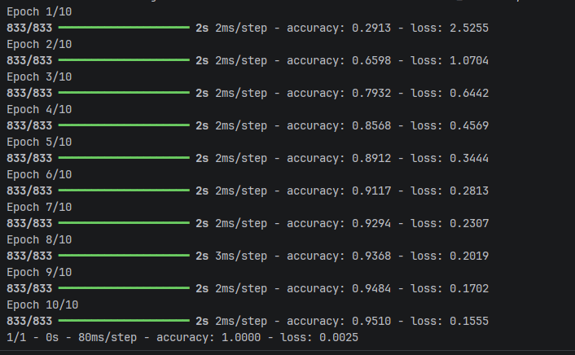


*Test 9;*

Dropout = 0.25

Conv2D 32, 64

```python
pool_size= (2,2)

TEST_SIZE = 1

EPOCHS = 10

optimizer="adam"

loss="categorical_crossentropy"
```

Resultat de précision de 0.9910 et perte la plus haute 1.1802.
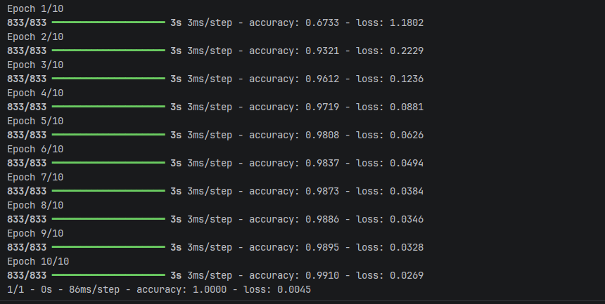


*Test 10;*

Dropout = 0.75

Conv2D 32, 64

```python
pool_size= (2,2)

TEST_SIZE = 1

EPOCHS = 10

optimizer="adam"

loss="categorical_crossentropy"
```

Resultat de précision de 0.8854 et perte la plus haute 2.2115.
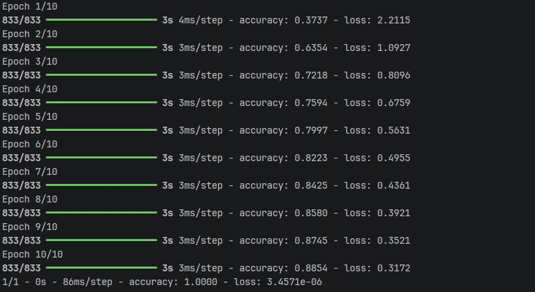

*Test 11;*

Dropout = 0.25

Conv2D 32, 64

```python
pool_size= (2,2)

TEST_SIZE = 10

EPOCHS = 10

optimizer="adam"

loss="categorical_crossentropy"
```

Rajouter un plus gros TEST_SIZE. Précision de 0.9884 et perte la plus haut de 1.2321.
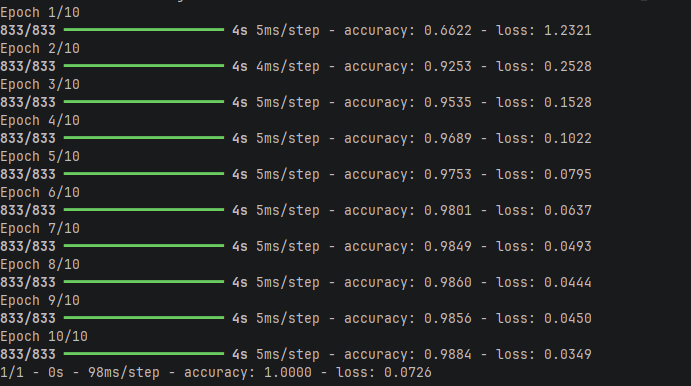

*Test 12;*

Dropout = 0.25

Conv2D 32, 64

```python
pool_size= (2,2)

TEST_SIZE = 20

EPOCHS = 10

optimizer="adam"

loss="categorical_crossentropy"
```

Rajouter un encore plus gros TEST_SIZE. Précision de 0.9913 et perte la plus haut de 1.1070.
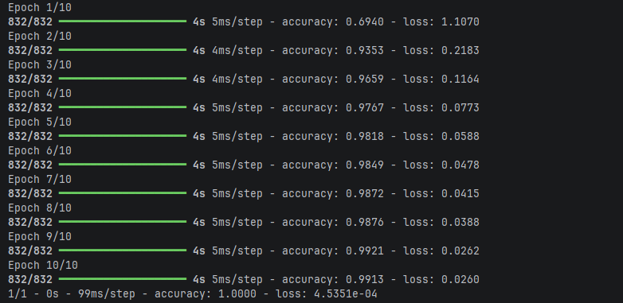

***Conclusion***

Les tests montrent qu’un réseau sans convolution (Test 0) reste faible(39 %). Dès qu’on ajoute Conv2D et MaxPooling2D, la précision dépasse 97 %.
La configuration la plus efficace est deux Conv2D (32 puis 64), un pooling (2, 2), la perte categorical_crossentropy et un Dropout de 0,25. 
Avec un TEST_SIZE plus grand (Test 12), on atteint environ 99,1 % de précision. 
Un pooling trop grand (3×3 ou 4×4), un Dropout trop élevé (0,75) ou trop de couches Conv2D dégradent les résultats, voire font planter le modèle.

*Autre observation:*
- Beaucoup plus lent a l'ecole que a la maison.